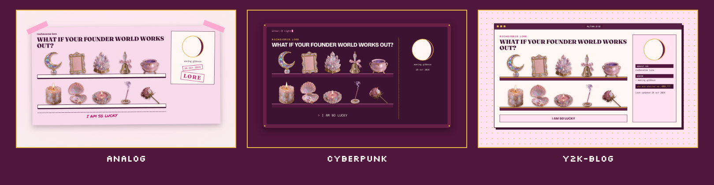
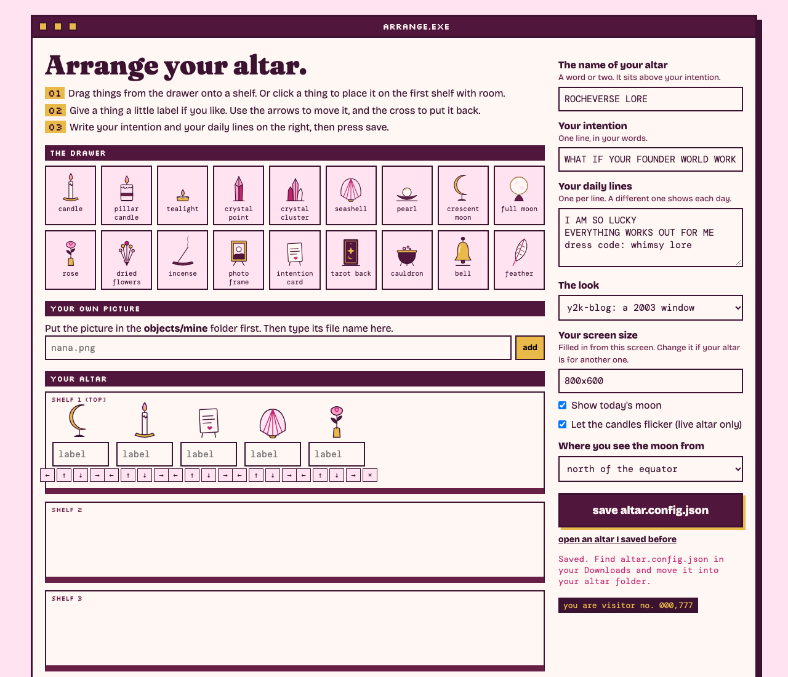

# Desktop Altar

*Rocha Coded. Free tools from the Rocheverse.*

**Turn your desktop into an altar. You decide what sits on it.**

Candles, crystals, a shell, a pearl, a rose, your own photos.
Your intention across the top, written in your words.
Today's real moon beside it, and a line that greets you each new day.
Keep it as a still wallpaper, or put it live so the candles flicker and the moon turns with the nights.

<p align="center"></p>

<p align="center"></p>

<p align="center"><sub>One altar, three moods: analog, cyberpunk, y2k-blog. This one is Rocha's. Yours holds whatever you choose.</sub></p>

## Start here
You can do this. Each step tells you what to type and what you will see when it worked.

**If you use Claude Code** (Claude in the terminal, the window where you type commands to your computer):

 Open the Terminal app. On a Mac it is in Applications > Utilities > Terminal.
   This checks that Python, the language the tool is written in, is ready:
   ```sh
   python3 --version
   ```
   You will see `Python 3.10` or a higher number.

 This copies the tool onto your computer. "Clone" means download a copy from GitHub, the site where the code lives:
   ```sh
   git clone https://github.com/RochaStone/desktop-altar ~/.claude/skills/desktop-altar
   ```
   You will see `Cloning into...` and then the line where you type comes back.

 This makes a folder for your altar and opens Claude Code inside it:
   ```sh
   mkdir -p ~/my-altar && cd ~/my-altar && claude
   ```
   You will see Claude Code open and wait for you.

 Type this to Claude, in your own words if you like:
   ```
   Turn my desktop into an altar.
   ```
   Claude asks what you want on your altar. Name three things. Then it asks your intention this moon.

 When Claude says READY, your wallpaper is waiting:
   ```sh
   open out/altar.png
   ```
   You will see your altar at the size of your screen. Claude offers to set it as your wallpaper, then asks if you want it live.

**If you use Claude Cowork** (the Claude desktop app): download the zip (one file that holds the whole tool),
upload it in Customize > Skills, give a task your altar folder, and say "Turn my desktop into an altar."
The full steps are under [Claude Cowork](#claude-cowork).

<p align="center"></p>

## What you get
- **A drawer of eighteen altar objects.** Candle, pillar candle, tealight, crystal point, crystal cluster, seashell, pearl, crescent moon, full moon, rose, dried flowers, incense, photo frame, intention card, tarot card, cauldron, bell and feather. Each one is drawn flat in your colours.
- **Your own things.** Drop a picture into `objects/mine` (a photo, a drawing, your dog) and it sits on the shelf beside the rest.
- **Your intention.** One line, in your words, across the top.
- **Today's moon.** Worked out on your computer from the astronomy itself, with no app and no account.
- **A daily line.** Give it a few lines and a different one greets you each day.
- **A wallpaper picture** at the exact size of your screen, for any computer with nothing to install.
- **A living altar page** where the candles flicker, the incense drifts and the moon keeps true for months.
- **Candles you light yourself.** In the living altar, click a candle or the incense to light it or snuff it. Your altar remembers.
- **A painted drawer.** `objects/painted/` holds painted cutouts. Use one with `"type": "painted/candle.png"`. If a painted file is missing, the flat drawing of the same name stands in.
- **A drag-and-drop arranger.** `arrange.html` opens in your browser. Drag things onto the shelves and press save.

<p align="center"></p>

<p align="center"></p>

## Install
It runs inside Claude. The tool needs no account and sends nothing anywhere.

| Where you use it | Install it | Start it |
|---|---|---|
| [Claude Code](#claude-code) (recommended) | clone into `~/.claude/skills` | ask "turn my desktop into an altar" |
| [Claude Cowork](#claude-cowork) | upload `desktop-altar.zip` as a skill | ask for your altar in a Cowork task |

You need Python 3.10 or newer. Google Chrome makes the wallpaper picture; the living page works without it.

### Claude Code
```sh
git clone https://github.com/RochaStone/desktop-altar ~/.claude/skills/desktop-altar
```
Open Claude Code in the folder where you want your altar, and ask: "Turn my desktop into an altar."
To update later: `git -C ~/.claude/skills/desktop-altar pull`.

### Claude Cowork
Cowork (the Claude desktop app) runs tasks in a sandbox on your computer that can only reach the folders you give it.
1. Download `desktop-altar.zip` from the [latest release](https://github.com/RochaStone/desktop-altar/releases/latest).
2. In the Claude desktop app: Customize > Skills, then + > Create skill > Upload a skill, and pick the zip.
3. In Settings > Capabilities, turn on code execution and file creation.
4. Make a folder for your altar, for example `my-altar` in your home folder. Start a Cowork task, give it access
   to that folder, and ask: "Turn my desktop into an altar."

Cowork builds the `out` folder. Setting the wallpaper and going live happen on your computer, and Claude gives you each click.

### By hand, with no Claude at all
1. Open `arrange.html` in your browser. Drag things onto the shelves, write your intention, press **save altar.config.json**.
2. Move the downloaded file into this folder. Then, in the terminal, from this folder:
   ```sh
   python3 build.py altar.config.json --out out/
   ```
   You will see `READY. Your altar is in out/`.

<p align="center"></p>

## Make it yours
Your look lives in one file, `style.json`: your colours, your fonts, your motif and one stamp word.
It ships with two examples: `examples/style.rocha-coded.json` (my plum and blush) and a blank `style.example.json` for yours, explained in `STYLE.md`. Or ask Claude to make one with you from a few references.
Pick your motif, `analog`, `cyberpunk` or `y2k-blog`, to change the structure. Your palette re-tones every object in the drawer and all three motifs, so every version is yours to curate.
The same file works across every Rocha Coded tool, so you make it once.

Your altar itself lives in `altar.config.json`. Start from the blank `altar.example.json`, or see mine in `examples/altar.rocha-coded.json`.

<p align="center"></p>

## Go live
The wallpaper picture is a still. To have the candles flicker and the moon change each night, show `out/altar.html` with a free wallpaper app.
These apps belong to other people, and they are lovely. This kit makes a file they can show. Their code is theirs and stays with them.

### Light and snuff your candles
In the living altar, click a candle or the incense to light it or snuff it. You can also press Tab to reach it and Enter to click.
The altar remembers which ones you snuffed, on that computer, until you light them again.
The wallpaper picture is a still, so clicking it does nothing. Clicking works in the living altar only, and only when your wallpaper app lets clicks through:
- **Plash (Mac):** turn on **Browsing Mode** from the Plash menu. Click your candles, then turn Browsing Mode off so your desktop icons work again.
- **Lively (Windows):** turn on the interactive setting for your wallpaper in Lively (it may be called Wallpaper Input; set it to Mouse).
- **Übersicht (Mac):** it passes clicks to your altar the way its Preferences say. If a click lands on the desktop instead, look for the interaction setting there.

### Plash (Mac)
1. Get Plash from [sindresorhus.com/plash](https://sindresorhus.com/plash). It is free on the Mac App Store.
2. Open it. A small Plash icon appears in the menu bar, the strip along the top of your screen.
3. Click the icon, then **Add Website**.
4. In the window that opens, choose **Local Website**, then pick your `out` folder (or the `altar.html` inside it). Click **Add**.
5. Your altar now sits on your desktop, behind your icons. Keep Browsing Mode off so your clicks go to your desktop.

### Lively Wallpaper (Windows)
1. Get Lively Wallpaper from the [Microsoft Store](https://apps.microsoft.com/store/detail/9NTM2QC6QWS7). It is free.
2. Open Lively. Click the **+** (Add Wallpaper) button at the top.
3. Choose **Browse** under the file option, and pick `out\altar.html`. You can also drag `altar.html` straight into the Lively window.
4. Your altar appears in the Lively library. Click it, and it becomes your wallpaper.

### Uebersicht (Mac)
Übersicht shows little web pages on your desktop. It is another way to go live on a Mac.
1. Download it from [tracesof.net/uebersicht](https://tracesof.net/uebersicht/) and open it. Its icon appears in the menu bar.
2. Click the icon, then **Open Widgets Folder**.
3. Copy the `altar.widget` folder from your `out` folder into that widgets folder.
4. Your altar fills the desktop within a few seconds. If it does not, click the icon, then **Refresh All Widgets**.

## If it goes wrong (everyone's first time) 
This happens to everyone the first time. Here are the most common moments and the fix for each.
- **The terminal says `command not found` for `python3` or `git`.** Your Mac may offer to install its developer tools. Click Install, wait for it to finish, and run the step again. If nothing pops up, install Python from python.org.
- **The build says "A few things to fix in your altar first".** It lists each one in plain words, like a picture it could not find in `objects/mine`. Fix those, or ask Claude to, and build again.
- **The build says Chrome is missing.** Your `altar.html` is still ready. Install Google Chrome and build again for the wallpaper picture, or go live with the page alone.
- **Plash shows a blank page.** Open the Plash menu, choose your altar, and click **Reload**. If it stays blank, try the Übersicht steps instead: they show the same altar.
- **Lively shows the wallpaper but the moon looks old.** Lively may pause a wallpaper while an app is full screen. Click the desktop, and it carries on.
- **My own photo is missing.** Check the picture sits in `objects/mine` next to your `altar.config.json`, and the name in the config matches it exactly, `.png` and all.

<p align="center"></p>

## What's inside
| File | What it does |
|---|---|
| `SKILL.md` | the steps Claude follows: three things, your intention, the build, going live |
| `build.py` | checks your altar, finds your style, writes `out/altar.html`, `out/altar.png` and `out/altar.widget/` |
| `altar_page.py` | draws the altar page, all three motifs from one function |
| `altar_moon.py` | the moon maths, worked out on your computer |
| `arrange.html` | the drag-to-arrange page, one file, opens in any browser |
| `objects/` | the drawer of altar objects, `objects/painted/` for painted cutouts, and `objects/mine/` for your own pictures |
| `altar.example.json`, `examples/altar.rocha-coded.json` | a blank altar for you, and mine |
| `examples/style.rocha-coded.json`, `style.example.json`, `STYLE.md` | Rocha's example style, your blank one, and what each key does |
| `scripts/render.py` | headless Chrome for the wallpaper picture and the checks |
| `scripts/make-readme-images.py` | makes every image in this README from the tool itself, listed in `docs/IMAGES.md` |
| `tests/` | the tests, and `tests/TESTING.md` with exactly what was run |

Everything is plain Python from the standard library and plain HTML. You install no packages.
The page loads its fonts from Google Fonts and falls back to fonts already on the computer when offline.

For the curious, try another look or another screen by hand:
```sh
python3 build.py altar.config.json --out out/ --motif cyberpunk --size 1440x900
```

## Credits
- **Plash** by Sindre Sorhus: the free Mac app that shows a web page as your wallpaper. It is no longer open source. Its GitHub repository holds no licence file and its readme says the source is closed (checked 28 Oct 2026). This kit uses none of its code.
- **Lively Wallpaper** by rocksdanister and the [lively-community](https://github.com/lively-community/lively) contributors: GPL-3.0. This kit uses none of its code.
- **Übersicht** by Felix Hageloh ([felixhageloh/uebersicht](https://github.com/felixhageloh/uebersicht)): GPL-3.0. This kit writes a widget file for it and uses none of its code.
- **The moon** follows Jean Meeus, *Astronomical Algorithms* (2nd edition), chapter 49, ported from the sibling Rocha Coded kit analog-bag (MIT).
- **The style loader and the Chrome helper** come from the sibling kit desktop-core (MIT).
- **The painted drawer** is generated art made for this kit, cut out on-device. See `docs/IMAGES.md`.
- **Fonts** from Google Fonts under the SIL Open Font License: Fraunces, Bricolage Grotesque, DM Mono, Permanent Marker, Pinyon Script and Silkscreen.

## Licence
MIT. See [LICENSE](LICENSE). Copyright (c) 2026 Rochelle Livingstone / Thriving Era Studio.

 [Sign my guestbook](https://github.com/RochaStone/desktop-altar/issues)

## Made by Rocha

Rocha \
Brand Alchemist & AI Architect \
Author of *Brand Alchemy in the Thriving Era* \
Creator of [Conscious Founder Operating System](https://founders.thrivingera.com) \
Founder, [Thriving Era Studio](https://thrivingera.com)

I help female founders build their founder world, and I build what they need next. \
Start with the audit: [thrivingera.com/audit](https://thrivingera.com/audit). \
Or book an exploratory call: [calendly.com/rochelle-thrivingera/exploratory-call](https://calendly.com/rochelle-thrivingera/exploratory-call). It is where we decide if we work together.

[Instagram @rocheverse](https://instagram.com/rocheverse) · [Substack](https://rochastone.substack.com) · [LinkedIn](https://www.linkedin.com/in/rochellelivingstonecosmic) · [More free tools](https://thrivingera.com/free) · [All tools on GitHub](https://github.com/RochaStone)
